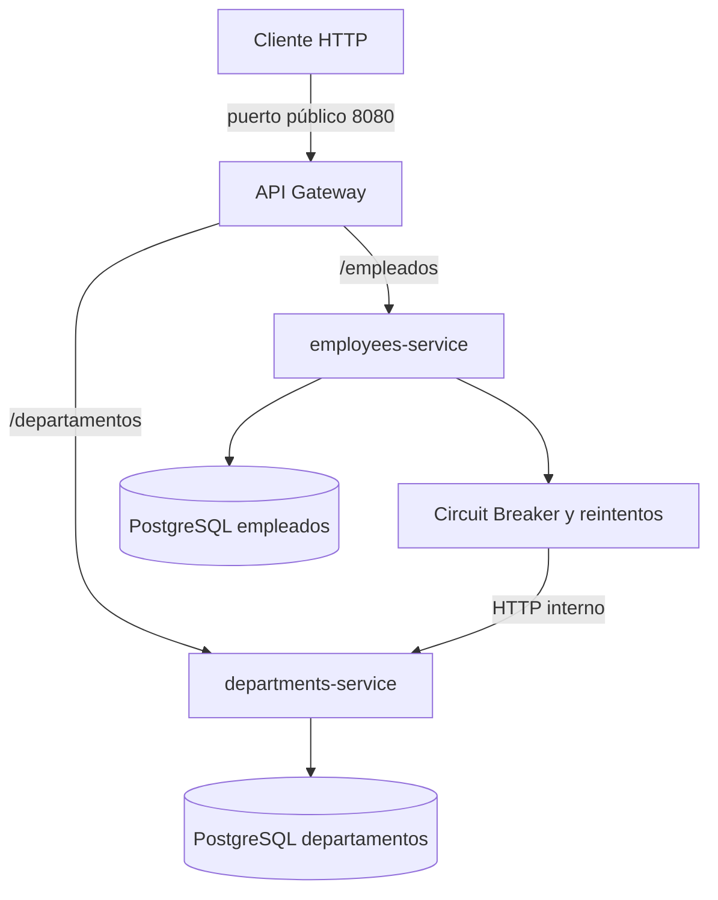

# Arquitectura del sistema

## Entrada pública

El cliente utiliza exclusivamente el API Gateway en `http://localhost:8080`. Compose solo publica el puerto del Gateway. Empleados, departamentos y sus bases de datos se comunican mediante la red interna de Docker.

## Responsabilidades

El Gateway enruta, expone su propia salud y maneja errores de comunicación. Empleados valida el registro y consulta el catálogo. Departamentos administra ese catálogo. Cada servicio posee su base de datos y sus migraciones; no se comparten tablas.

## Resiliencia síncrona

Resilience4j protege la consulta de empleados a departamentos. Las comprobaciones locales y la persistencia no forman parte de ese circuito.

CLOSED permite consultas. Tres operaciones consecutivas fallidas abren el circuito. OPEN evita acceder a la red durante 30 segundos. HALF_OPEN permite una operación de prueba; una respuesta válida cierra el circuito y un fallo de disponibilidad lo vuelve a abrir.

Los reintentos se ejecutan dentro de cada operación protegida. Un 404 del proveedor es una respuesta válida de comunicación y se convierte en 400 de negocio para el registro.

## Decisión de negocio

Ante indisponibilidad se rechaza el registro con 503, sin guardar datos sin validar. La recuperación es automática; el solicitante puede reintentar. No se utiliza un estado pendiente ni se requiere reconciliación por este fallback.

## Observación y verificación

`/empleados/circuit-breaker` expone estado y contadores a través del Gateway. Los logs de empleados registran las transiciones. La prueba integral se encuentra en `tests/reto3_smoke.py` desde la raíz del repositorio.

Las decisiones de persistencia de retos anteriores permanecen en `docs/decisions/`.
