# Evidencias del Reto 7

Validación realizada el 28 de octubre de 2026 sobre una copia Git local de la
rama **valentina**. El trabajo del repositorio está en esa rama. `main` conserva
el commit `3457adba5601cb468b4ef86a10325534bbd45af8`.

## Tres ejecuciones consecutivas

| Pipeline | Primera | Segunda | Tercera | Resultados publicados por build |
|---|---|---|---|---|
| employees-service | [#9](http://localhost:9091/job/employees-service/9/) SUCCESS | [#10](http://localhost:9091/job/employees-service/10/) SUCCESS | [#11](http://localhost:9091/job/employees-service/11/) SUCCESS | 77 pruebas Java + 39 escenarios BDD; 0 fallos, 0 omisiones |
| vacations-service | [#8](http://localhost:9091/job/vacations-service/8/) SUCCESS | [#9](http://localhost:9091/job/vacations-service/9/) SUCCESS | [#10](http://localhost:9091/job/vacations-service/10/) SUCCESS | 64 pruebas TypeScript + 39 escenarios BDD; 0 fallos, 0 omisiones |

Después de las simulaciones y de recrear Jenkins se ejecutaron las verificaciones
finales: empleados **#15 SUCCESS** y vacaciones **#17 SUCCESS**. El historial,
las credenciales y los jobs se conservaron. Los builds previos también incluyen
las ejecuciones de diagnóstico y los fallos deliberados; no todos deben estar en verde.

Estas ejecuciones corresponden a la validación histórica del 28 de octubre. La
instancia Jenkins actual usa el puerto 9091 y puede tener un volumen de builds
distinto; los números antiguos no se consideran verificados hasta repetirlos allí.

## Fallos controlados

| Caso | Build | Primera etapa fallida | Diagnóstico publicado |
|---|---|---|---|
| Unitaria | [vacaciones #11](http://localhost:9091/job/vacations-service/11/) | Test | «Fallo deliberado del reto 7», con el mensaje «Jenkins debe identificar esta prueba en Test Result.» |
| Cobertura | [vacaciones #14](http://localhost:9091/job/vacations-service/14/) | Quality Gate | SonarQube: 23,9 %, por debajo del 70 % |
| Dockerfile | [vacaciones #15](http://localhost:9091/job/vacations-service/15/) | Package | Reporte HTML Empaquetado Docker: instrucción INSTRUCCION_INEXISTENTE en la línea 35 |
| BDD | [vacaciones #13](http://localhost:9091/job/vacations-service/13/) | E2E Tests | «El pipeline identifica un fallo BDD»: se esperaba HTTP 599 y se recibió 200 |

El fallo de Dockerfile también se verificó en el build #12; #15 incluye además
el diagnóstico HTML. Los cambios deliberados solo se aplicaron en el workspace.
Las ejecuciones finales volvieron a descargar el código limpio.

## Métricas

| Proyecto | Cobertura combinada de SonarQube | Cobertura de líneas | Gate |
|---|---|---|---|
| Empleados | 82,4 % | 90,3 % | OK |
| Vacaciones | 78,9 % | 78,3 % | OK |

SonarQube analizó 1.230 líneas Java y 1.855 líneas TypeScript, además del POM.
La configuración de cobertura y sus exclusiones están explicadas en la
[guía del reto](../../GUIA-RETO7.md). No son porcentajes de todo el ecosistema.

Los datos exportados están en [ejecuciones.json](ejecuciones.json),
[sonar-final.json](sonar-final.json) y
[sonar-cobertura-fallida.json](sonar-cobertura-fallida.json).
Los enlaces a Jenkins requieren el entorno local encendido; las capturas quedan
versionadas y se pueden consultar sin Jenkins.

## Capturas reales

### Pipeline y rama

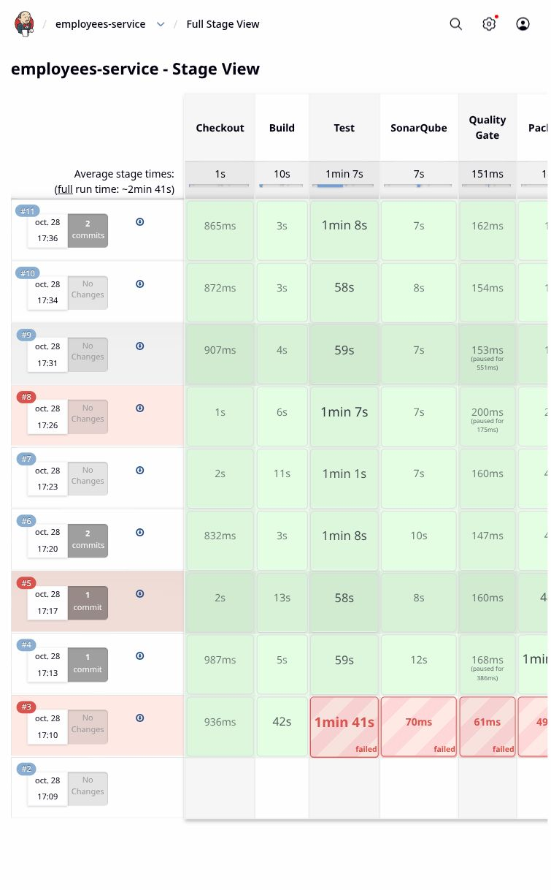

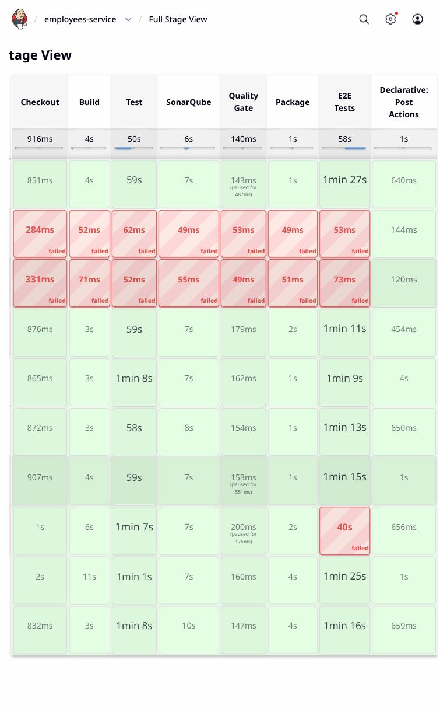

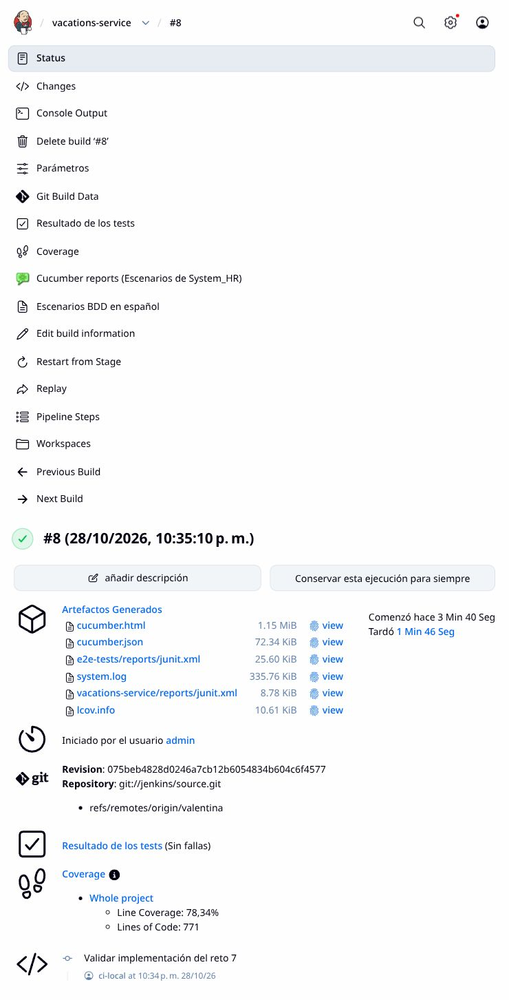

### Pruebas y cobertura

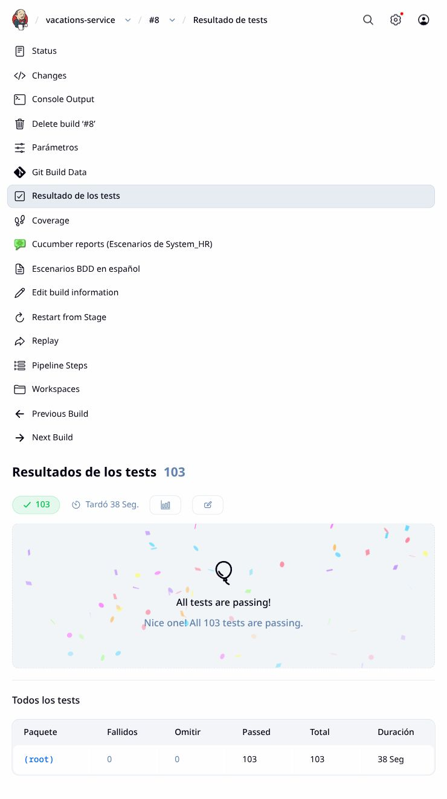

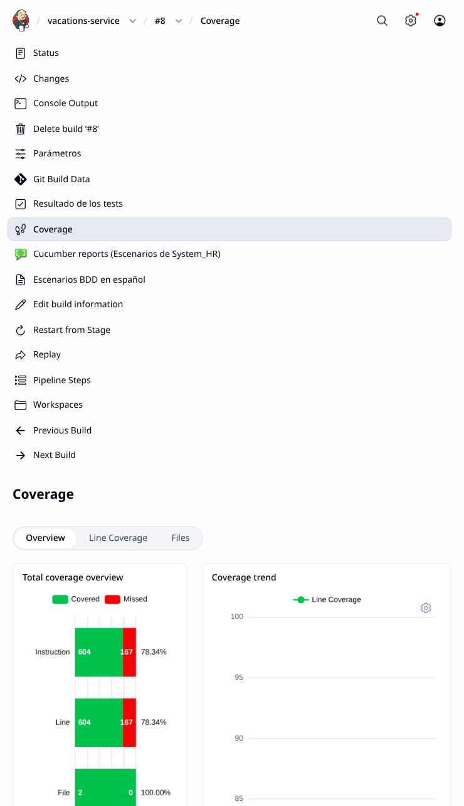

### BDD navegable

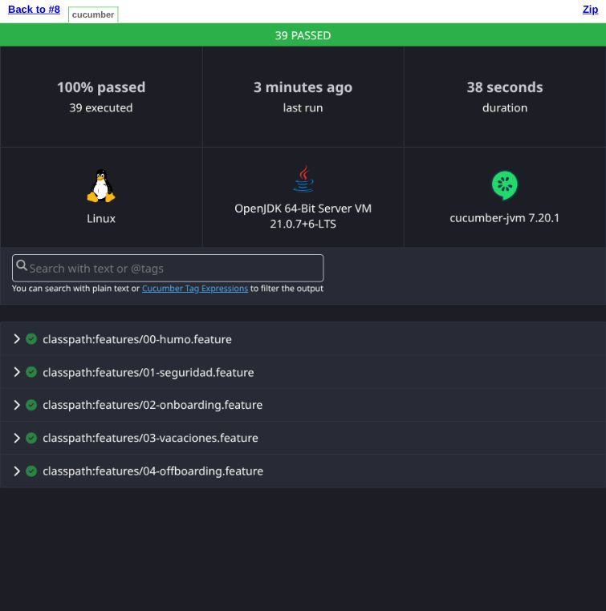

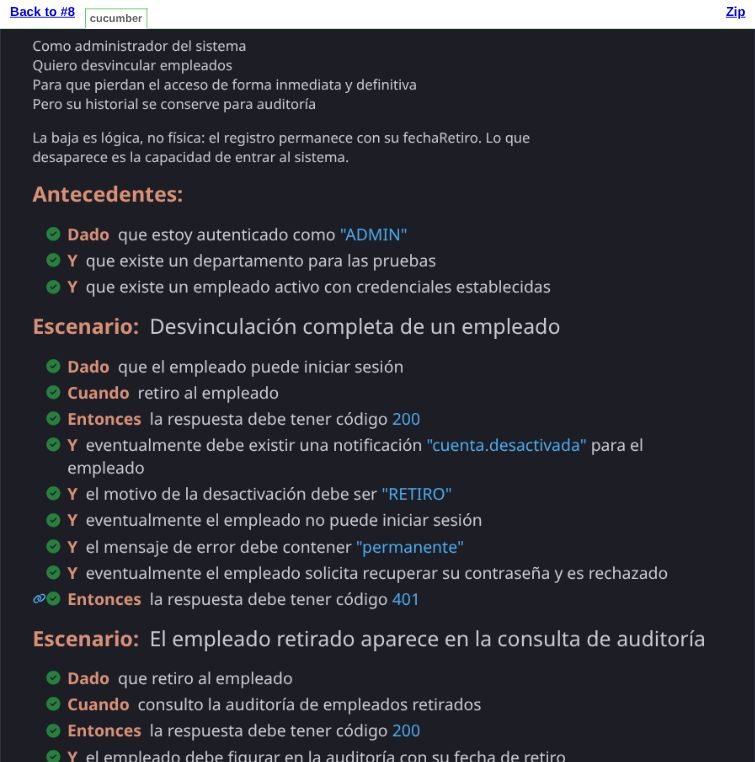

### Fallos identificados

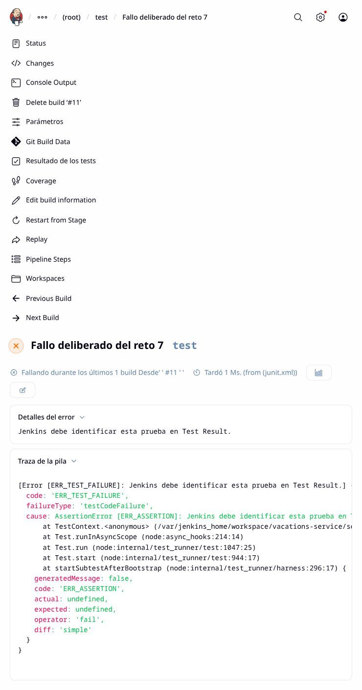

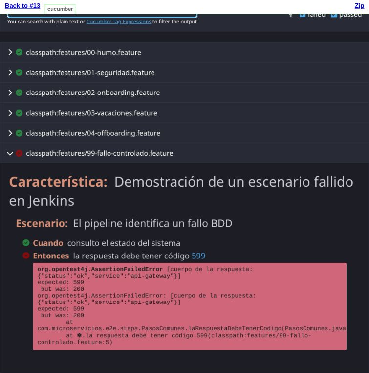

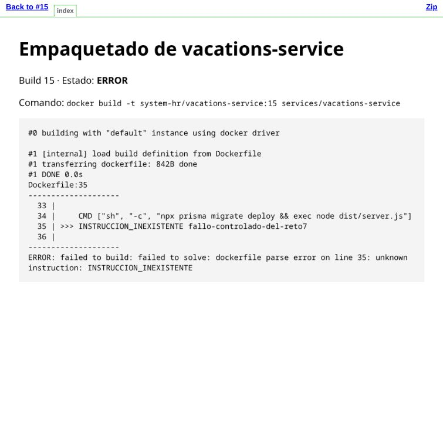

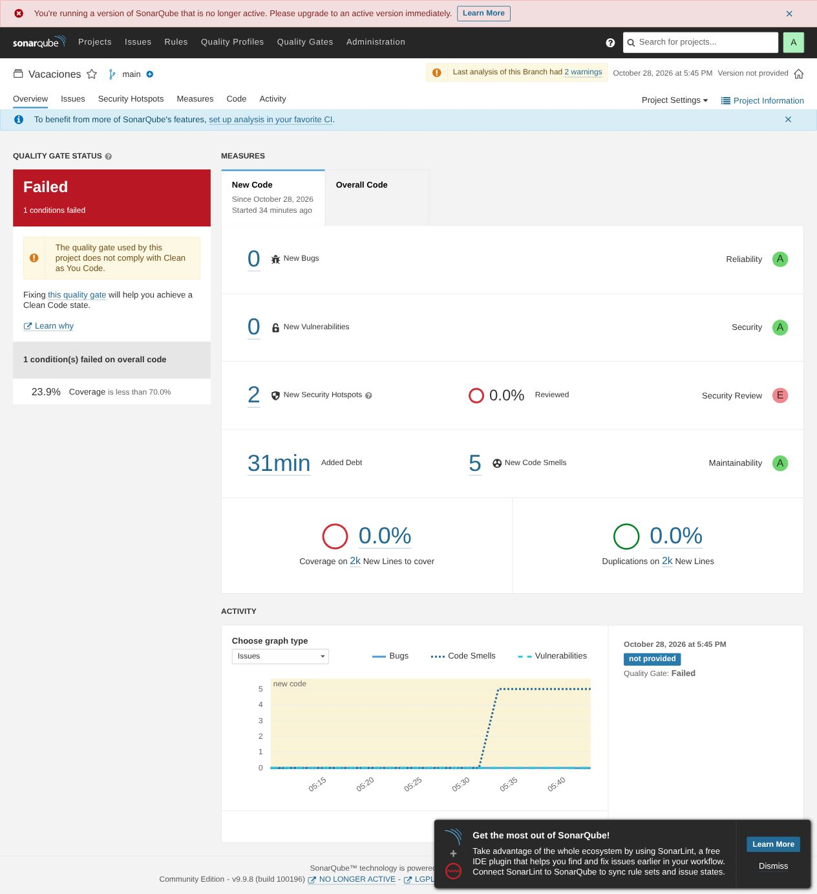
